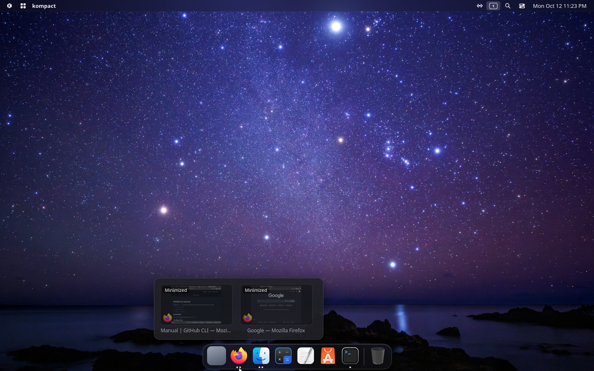
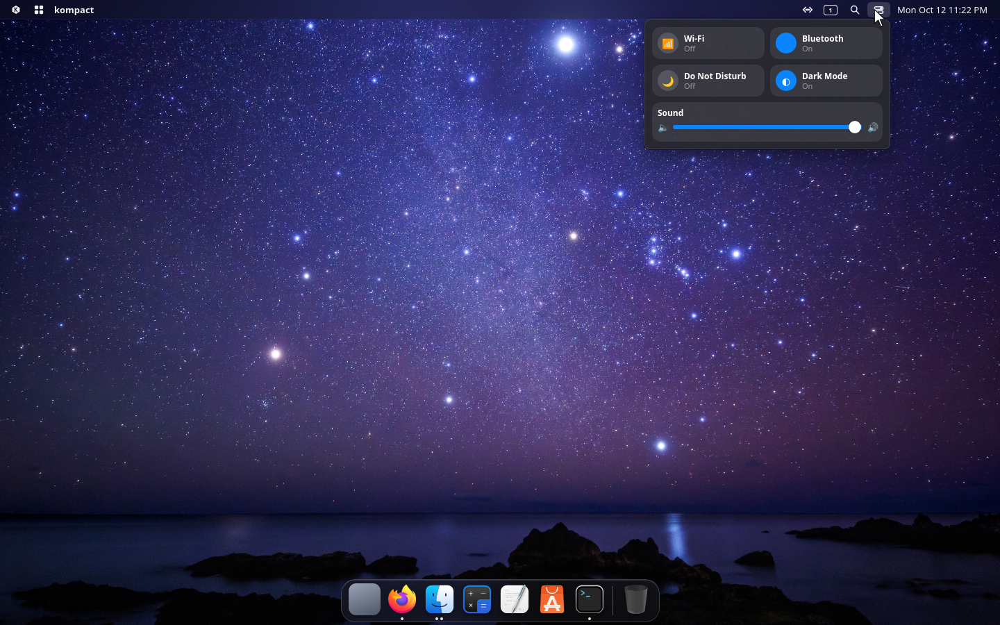
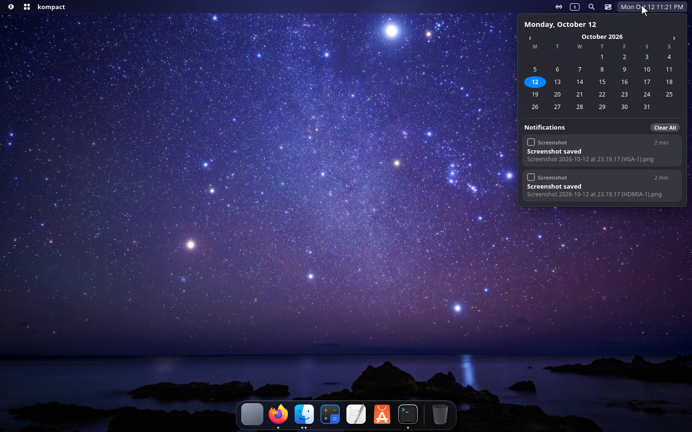
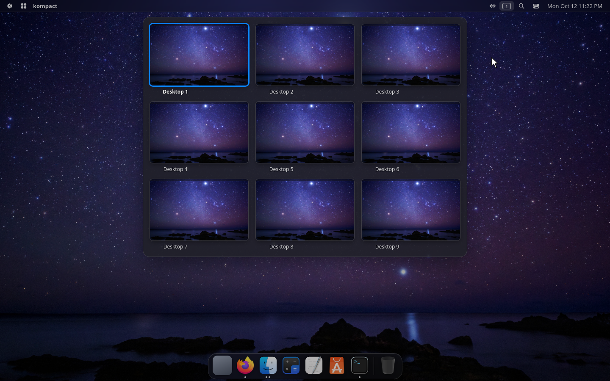
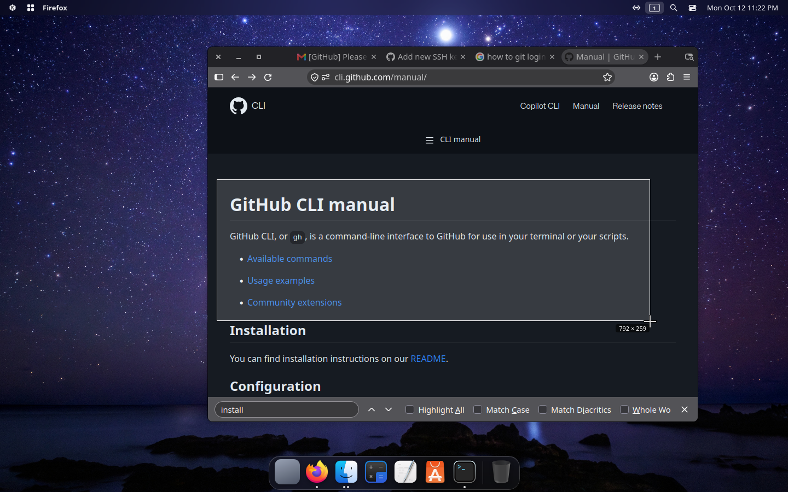
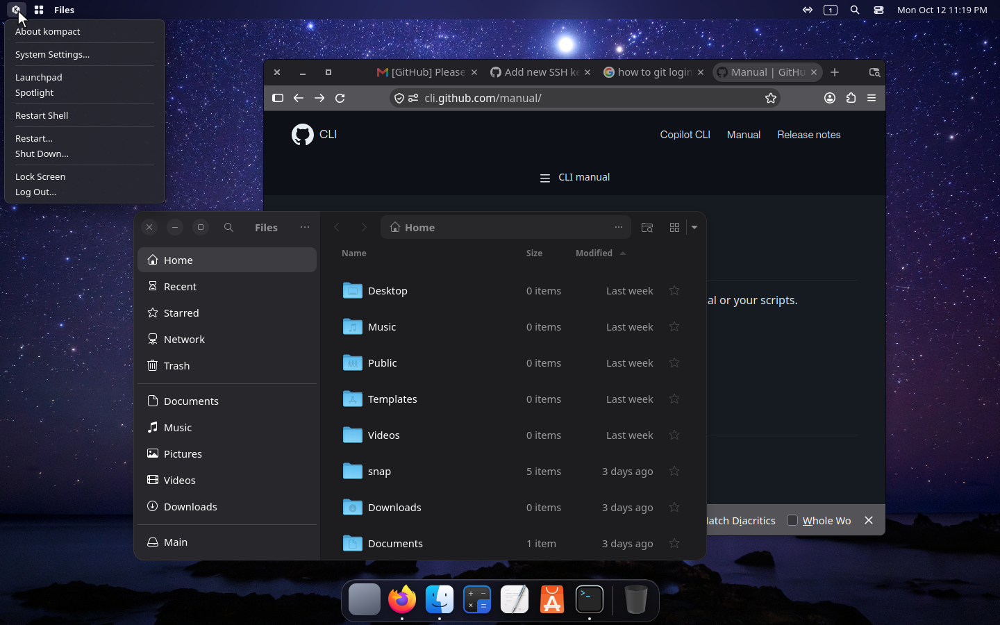
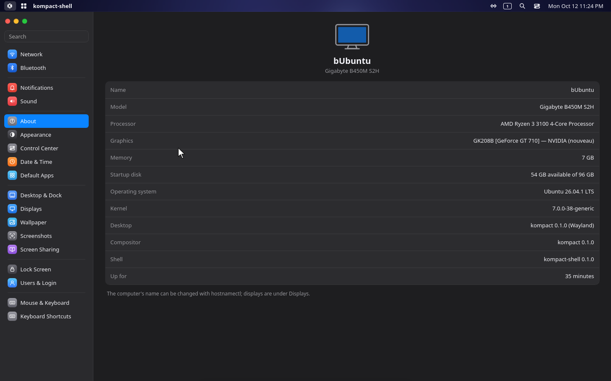

# kompact desktop

A Wayland desktop for Linux, written from scratch: a compositor (**kompact**) and a macOS-style
shell on top of it (**kompact-shell**: menu bar, dock, Spotlight, System Settings, lock and login
screens).



It started as a curiosity: *can an AI build something as complex as a desktop, if a person only
plans and tests?* Every line of code in this repository was written by
[Claude](https://claude.ai) (Anthropic's AI) working in Claude Code. The project's owner wrote no
code. They decided what to build, ran every build on real hardware, and reported back what worked
and what didn't. More on how that worked [below](#how-it-was-built).

```
┌──────────────────────────────────────────────────────────────┐
│  apps (Firefox, Files, foot, …)       kompact-shell          │
│  any Wayland app                      menu bar · dock ·      │
│                                       Spotlight · Settings   │
├───────────── Wayland protocols ──────────┬─ private socket ──┤
│                 kompact (the compositor)                     │
│  windows · input · monitors · rendering · lock · screen copy │
├──────────────────────────────────────────────────────────────┤
│         Linux: DRM/KMS · libinput · libseat · Mesa           │
└──────────────────────────────────────────────────────────────┘
```

## Screenshots

**Control Center**, from the menu bar: Wi-Fi, Bluetooth, Do Not Disturb, Dark Mode and sound.



**Calendar and notifications**, from the clock.



**Workspaces overview**: every desktop at a glance; click one to go there.



**Apps:** Firefox with kompact's region screenshot tool.



**The logo menu**, over Files and Firefox: System Settings, Launchpad, Spotlight, restart,
lock and log out.



**System Settings**, here the About pane with the compositor's and the shell's versions.



## The two parts

### kompact, the compositor (`kompact/`)

The compositor is the hard part of any Wayland desktop: it owns the screens, the keyboard and
mouse, and every window, and it draws everything you see. kompact is about 18,000 lines of Rust on
[Smithay](https://github.com/Smithay/smithay) 0.4.

- **Runs on real hardware** through DRM/KMS and libseat, from a text console or a login screen,
  or **nested in a window** inside another desktop (winit backend) for development.
- **Window management:** smart placement into open space, edge and corner snapping, maximize and
  fullscreen, resize from all eight edges, remembered window positions per app, workspaces,
  minimize, Alt+Tab, optional focus-follows-mouse.
- **Its own title bars** (macOS-style buttons and centred titles) for apps that ask for them,
  with minimize, maximize and snap animations.
- **Several monitors:** each runs at its own mode, with a remembered arrangement, a main display,
  and hotplug (where the hardware reports it).
- **Input:** keyboard layouts, Caps Lock options, key repeat, pointer speed and acceleration,
  natural scrolling per device, scroll speed. Every shortcut can be changed, with macOS,
  Windows 11 and classic presets.
- **Session:** a lock screen (ext-session-lock), lock after idle, screens off when idle, sleep
  with lock first, keep-awake for video players, clipboard and middle-click paste.
- **Capture:** screenshots built in, and screencopy for screen sharing through the desktop portal.
- **Measured, not guessed:** frame times, input latency and memory were measured on the target
  machine, and changes that touch performance are checked against those numbers
  (`kompact/ROADMAP.md`, "Phase 4 baseline").

Wayland protocols: `xdg_shell` (with real popup grabs), `wlr-layer-shell`, `xdg-decoration`,
`xdg-activation`, `linux-dmabuf`, `wl_shm`, data device, primary selection, `wlr-data-control`,
`cursor-shape`, `ext-session-lock`, `ext-idle-notify`, `idle-inhibit`, `wlr-screencopy`,
`wl_output` + xdg-output.

### kompact-shell, the desktop shell (`shell/`)

Everything you see that isn't an app: the menu bar with its status items (network, Bluetooth,
sound, Control Center, notifications, clock), the dock with magnification and window previews,
Spotlight and Launchpad, notifications, the wallpaper, and System Settings with eighteen
panes. It is a [Tauri 2](https://tauri.app) app: Rust (about 11,500 lines) for the system side
(D-Bus, NetworkManager, BlueZ, PipeWire, polkit, logind) and HTML/CSS/JS (about 8,000 lines) for
the looks, drawn on wlr-layer-shell surfaces. It also holds **Siva**, the assistant (the ring
in the menu bar, or Ctrl+Super+V): it hears you with whisper.cpp, answers with Piper and
understands with a small llama.cpp model, all on the CPU; it controls the desktop, types and
writes into apps through kompact, and looks things up online as Settings allows. It also does
real tasks: it writes files and runs commands in a terminal you can watch, working step by step
on a cloud AI with your own key or on a local coding model, and reads inside apps through
accessibility (AT-SPI), reading pages out on this PC. Drastic actions ask first, enforced in
code. The same crate builds two more programs:

- `kompact-lock`, the lock screen (gtk-session-lock + PAM);
- `kompact-greeter`, the login screen (for [greetd](https://sr.ht/~kennylevinsen/greetd/));
  kompact runs it in a locked-down greeter mode (`kompact --greeter …`).

## Build your own desktop on kompact

The compositor is where the difficult, low-level work lives: talking to the GPU and the kernel,
input devices, monitors, frame timing, window state. That part is done, and it has been used
every day on real hardware while the shell was built on it. A shell, by comparison, is ordinary
application code. You can write one in any language and any toolkit, and you can replace
kompact-shell entirely without touching the compositor.

A shell talks to kompact in two ways:

1. **Standard Wayland protocols.** Panels, docks, wallpapers and launchers are
   `wlr-layer-shell` surfaces, so existing tools work as they are: try `waybar`, `swaybg`,
   `fuzzel` or `mako` in a kompact session. Lock screens use `ext-session-lock` (`swaylock`
   works), and screenshots and screen sharing go through the usual portals.
2. **kompact's private socket** for what Wayland has no standard for. kompact listens on
   `$XDG_RUNTIME_DIR/kompact-$WAYLAND_DISPLAY.sock` and sends one JSON object per line: the
   window list (`windows`: id, app id, title, workspace, monitor, focused, minimized,
   maximized), shortcuts meant for the shell (`key`), the monitor under the pointer, settings,
   the keymap, screen-sharing state and so on. The shell sends one command per line, such as
   `activate <id>`, `close <id>`, `minimize <id>`, `thumb <id>` (a window thumbnail), `lock`,
   `logout`, `keys …` (read and change shortcuts) or `set <key> <value>` (settings).

   The format is documented at the top of `kompact/src/ipc.rs`, and the encoders and parsers
   there are unit-tested. `shell/src-tauri/src/compositor.rs` is a complete client to copy
   from. The socket is non-blocking on kompact's side, so a slow or crashed shell never stalls
   the desktop. Set `KOMPACT_SHELL=/path/to/your-shell` and kompact starts your shell, and
   restarts it if it crashes.

There's no `wlr-foreign-toplevel` support (yet), so taskbars written for other compositors won't
see the window list; use the socket's `windows` message instead.

## Install a release

Releases are `kompact-desktop-<version>-x86_64.tar.gz`, for Ubuntu 24.04 LTS or newer (or
Debian-based systems of the same age), on a real machine or in a VM with a virtual GPU:

```sh
tar -xzf kompact-desktop-<version>-x86_64.tar.gz
cd kompact-desktop-<version>-x86_64
sudo ./install.sh                # then pick "kompact" on your login screen
sudo ./install.sh --login-screen # also kompact's own login screen at boot
sudo kompact-uninstall           # removes it again
```

The installer gets the packages it needs with apt. Your current desktop stays and is still
offered on the login screen. Details are in the release's own `README.md`
(`release/files/README.md`).

## Build from source

Requirements:

- Rust: **1.86 or newer** for the compositor, **1.90 or newer** for the shell
  ([rustup](https://rustup.rs) is easiest).
- Compositor libraries: `sudo apt install pkg-config libwayland-dev libxkbcommon-dev
  libinput-dev libudev-dev libgbm-dev libdrm-dev libseat-dev libegl1-mesa-dev libgles2-mesa-dev`
- Shell libraries (WebKitGTK, GTK 3, gtk-layer-shell): `shell/install-deps.sh`

```sh
(cd kompact && cargo build --release)            # kompact/target/release/kompact
(cd shell/src-tauri && cargo build --release)    # kompact-shell, kompact-lock, kompact-greeter
```

Running it:

- **In a window, inside your current desktop** (the safest way to try compositor changes):
  `KOMPACT_SHELL=on kompact/target/release/kompact`. It picks the nested backend by itself. The
  shell has mostly been tested on real screens, so expect rough edges there.
- **On the real screens:** from a text console (Ctrl+Alt+F3, log in), run
  `kompact/ktest-desktop.sh`. Logs go to `kompact/ktest.log` and `shell.log`.
  Shift+Super+Escape quits.

Making a release: `./make-release.sh [version]` (for example `./make-release.sh 0.2.0`) sets the
version everywhere, runs the tests, builds, and writes `dist/kompact-desktop-<version>-x86_64.tar.gz`.

Tests: `cargo test` in `kompact/` and in `shell/src-tauri/`. Most of the logic (placement,
snapping, shortcuts, outputs, settings, the socket protocol) lives in pure modules with unit
tests, so it can be checked without a screen.

## How it was built

This project is an experiment in using an AI as the developer of a large, low-level program.

- **Claude was the developer.** It wrote all the code (the compositor, the shell, the lock and
  login screens, the scripts, the installer and these docs), read Smithay's source to check its
  work, and wrote the unit tests.
- **The project's owner was the planner and the tester.** They chose what to build ("make the
  entire desktop look like a Mac", "every shortcut should be editable"), approved each plan, ran
  every step on the real machine, and reported what they saw: "the window goes under the menu
  bar", "the scroll wheel goes the wrong way", "audio doesn't work over HDMI".

Some ground rules kept a machine that can freeze from freezing:

- **One small step per hardware test.** Each step has an ID (like `13f` or `14d-2`), a rollback
  build, and a line in `kompact/ROADMAP.md` that moves from Planned to Implemented to Confirmed
  only after the owner tested it.
- **The risky code is fenced off.** The DRM/KMS backend and the render path are only touched when
  a step needs it, and such a step is flagged before any code is written. A bad KMS state on the
  test machine's NVIDIA GT 710 (nouveau driver) has needed a full power cycle more than once.
- **Logic goes where tests can reach it.** Claude can't see the screen, so window placement,
  snapping, keymaps, monitor layout and similar logic are pure functions with unit tests, and
  only the wiring is left for the hardware test.
- **Measure before optimizing.** Performance work starts from numbers taken on the machine:
  frame times, missed frames, upload cost.

`kompact/ROADMAP.md` is the full record: fifteen phases, every step, every bug report and what
caused it. `CLAUDE.md` is the handoff note Claude reads at the start of each working session.

## Status and limits

- Used daily on one machine (NVIDIA GT 710 with nouveau, two monitors), and installed from a
  release on that machine. Other GPUs and VMs should work, since kompact only uses standard
  DRM/KMS, GBM and EGL, but they have seen little testing.
- No XWayland yet, so X11-only apps don't run.
- Screen sharing shares whole monitors, not single windows.

## Repository layout

| Path | What |
|---|---|
| `kompact/` | the compositor (`src/`, `ROADMAP.md`, `README.md` with its details, test scripts, `tools/`) |
| `shell/` | the shell: `src-tauri/` (Rust, plus `kompact-lock` and `kompact-greeter`), `web/` (pages) |
| `release/` | the release builder and the installer's files |
| `make-release.sh` | builds a release with a version number |
| `layer-test/` | a tiny wlr-layer-shell test client from Phase 1 |
| `attic/` | the first, GTK 4 shell, kept for reference |

## License

MIT, see `LICENSE`.
